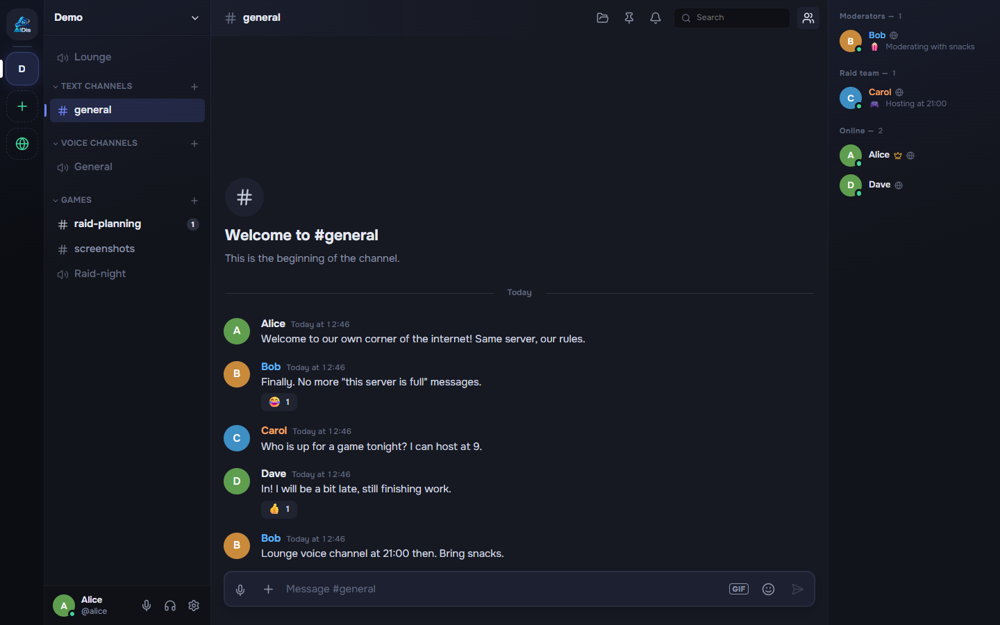
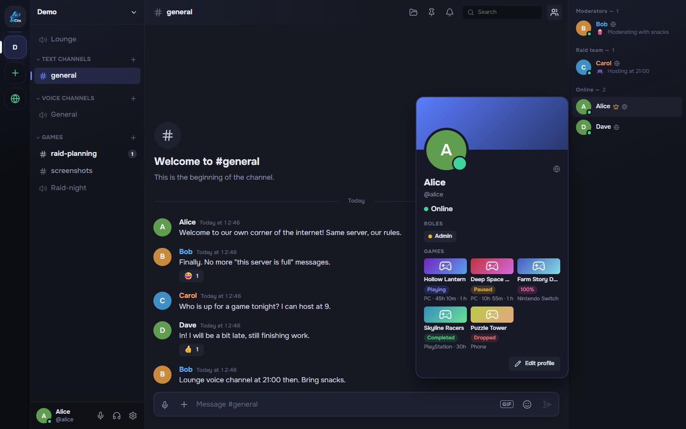
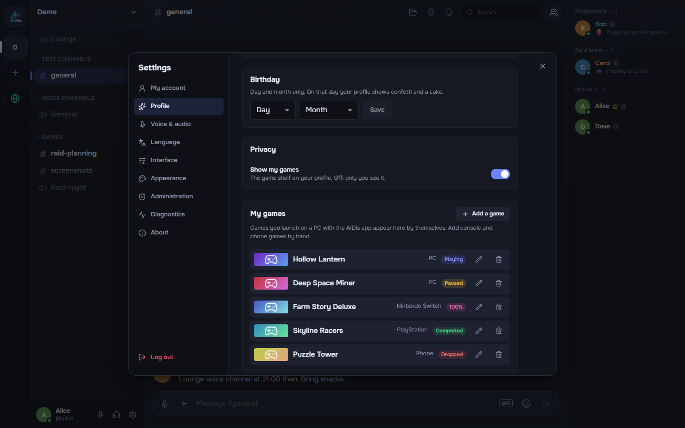
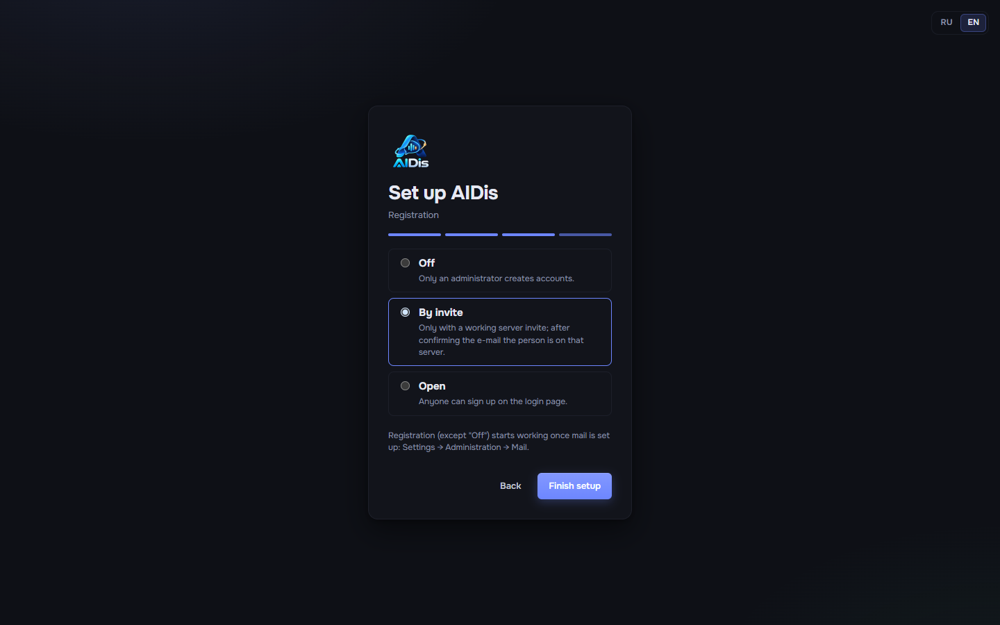
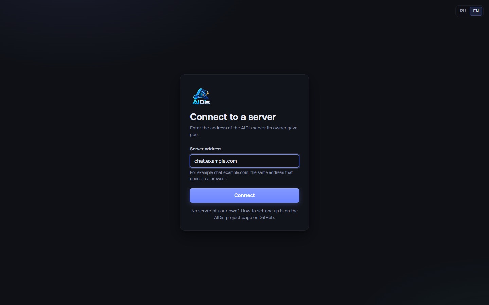

# AIDis

**A self-hosted place for your friends to talk: servers with text and voice channels, calls,
screen sharing, a game tracker and a Windows app. Your VPS, your domain, your data.**

[Русская версия](README.ru.md)



AIDis is for a group of friends, a guild or a small community that wants something like the big chat
apps, but running on a server they own. You rent a small VPS, point a domain at it, run one script,
and finish the setup in a browser. Nothing in AIDis talks to the authors' servers: there are none.

## What is inside

- **Servers and channels.** Text and voice channels, categories, roles and permissions, invite
  links, server emojis, an audit log.
- **Chat.** Replies, reactions, mentions, edits, files and images, link previews, voice messages,
  direct messages and friends.
- **Voice and video.** Calls in voice channels and DMs, screen sharing with sound, noise
  suppression, per-person volume, a soundboard. Media runs through your own LiveKit server; extra
  voice servers (for example closer to some of your friends) can be added later.
- **Game tracker.** Games you play on the PC appear by themselves with play time; console and phone
  games are added by hand. Statuses (playing, completed, 100%, dropped, paused), a shelf in every
  profile, and after two weeks without launching a game AIDis asks how it ended.
- **Windows app.** Global hotkeys, real push-to-talk that works in games, a screen picker with
  system audio, tray, autostart, notifications. One app connects to any AIDis server and updates
  itself from GitHub Releases.
- **For the owner.** A browser wizard on first start, registration off / by invite / open, e-mail
  confirmation and password reset through your SMTP, an administration panel, backups with one
  command.
- **Private by default.** No telemetry. Steam cover art and GIF search are off until you turn them
  on. Interface in English and Russian.

|  |  |
| --- | --- |
| Game tracker in a profile | Your games with statuses and platforms |
|  |  |
| First-run wizard | The desktop app asks for your server address |

## Quick start

You need a VPS with Ubuntu 22.04 or 24.04 (2 GB RAM or more) and a domain. Create two DNS records
pointing at the VPS: `chat.example.com` and `rtc.chat.example.com` (use your own domain). Then, on
the VPS:

```bash
sudo git clone https://github.com/OWNER/AIDis /opt/aidis
sudo bash /opt/aidis/deploy/setup.sh
```

The script asks three questions (domain, e-mail for the certificate, voice yes/no), installs Docker
if needed, gets HTTPS, builds and starts everything and prints a link like
`https://chat.example.com/setup?code=...`. Open it, create the administrator account and your
first server, and send the invite link to your friends.

Step by step, with what you should see at each step: [Installation guide](docs/en/install.md).

## Documentation

| Guide | What it covers |
| --- | --- |
| [Requirements](docs/en/requirements.md) | VPS size, domain, DNS records, ports |
| [Installation](docs/en/install.md) | `setup.sh` step by step, VPS that already runs nginx or other sites |
| [First run](docs/en/first-run.md) | The browser wizard, inviting friends, the administration panel |
| [Desktop app](docs/en/desktop-app.md) | Installing the Windows app, server address, several servers |
| [Voice](docs/en/voice.md) | How calls work, ports, extra voice servers |
| [Mail and registration](docs/en/mail-and-registration.md) | SMTP, registration modes, password reset |
| [Updating](docs/en/updating.md) | `update.sh`, versions of the desktop app |
| [Backups](docs/en/backups.md) | Backup, restore, moving to another VPS |
| [Troubleshooting](docs/en/troubleshooting.md) | "If you see X, do Y" |
| [FAQ](docs/en/faq.md) | Short answers |
| [Your own app builds](docs/en/build-your-own-app.md) | Building and publishing the desktop app from a fork |

Developers: [Server](Server/README.md), [Client](Client/README.md), [Desktop](Desktop/README.md),
[contributing](CONTRIBUTING.md), [security](SECURITY.md).

## License

AIDis is free software under the **GNU Affero General Public License v3.0** (see `LICENSE`). You
may run it, change it and share it. If you run a changed version for other people over a network,
you must offer them its source code.
