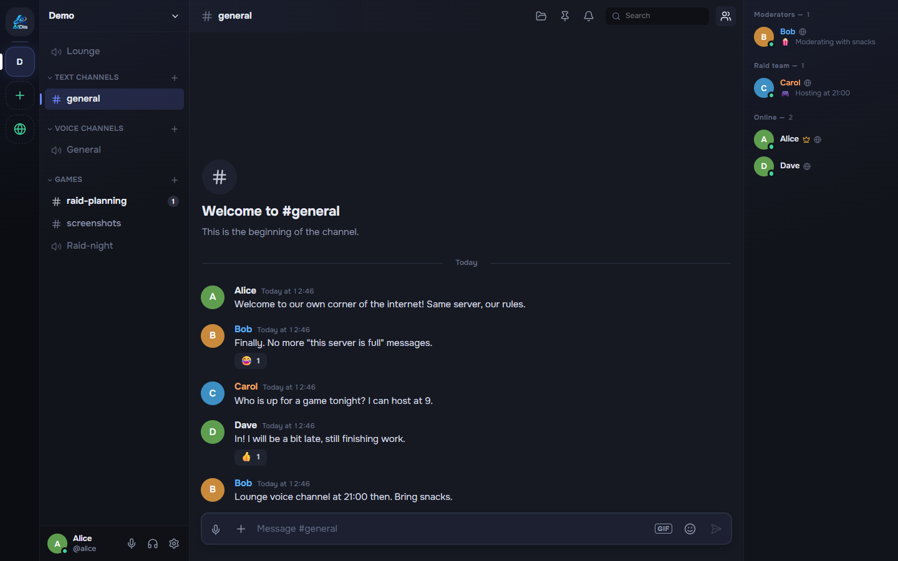
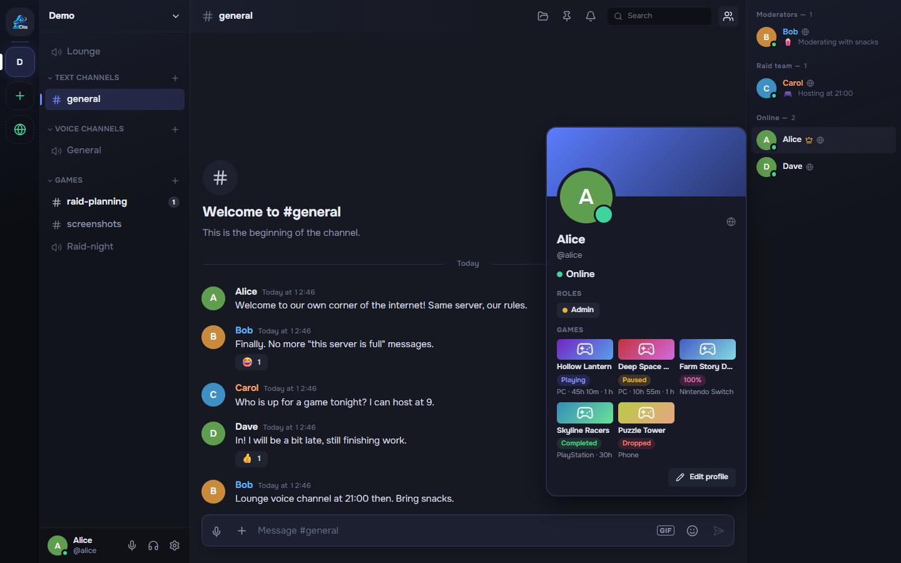
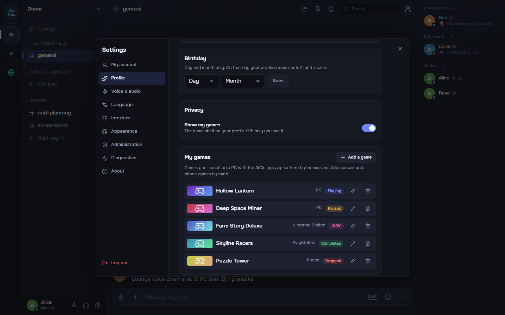
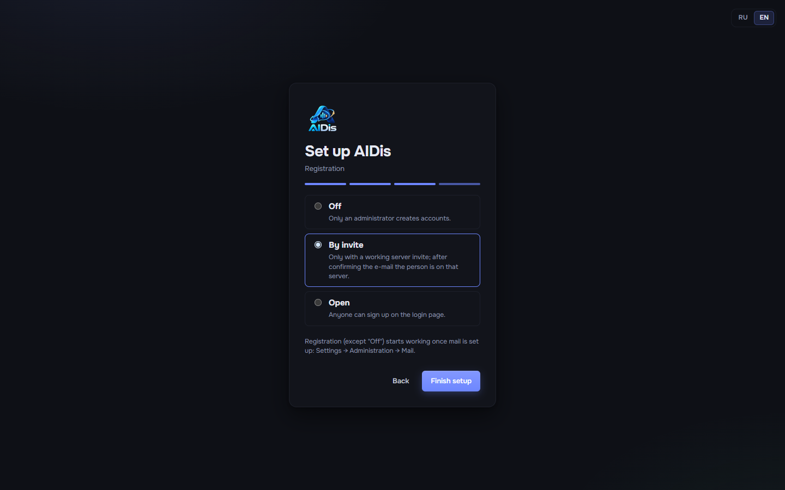
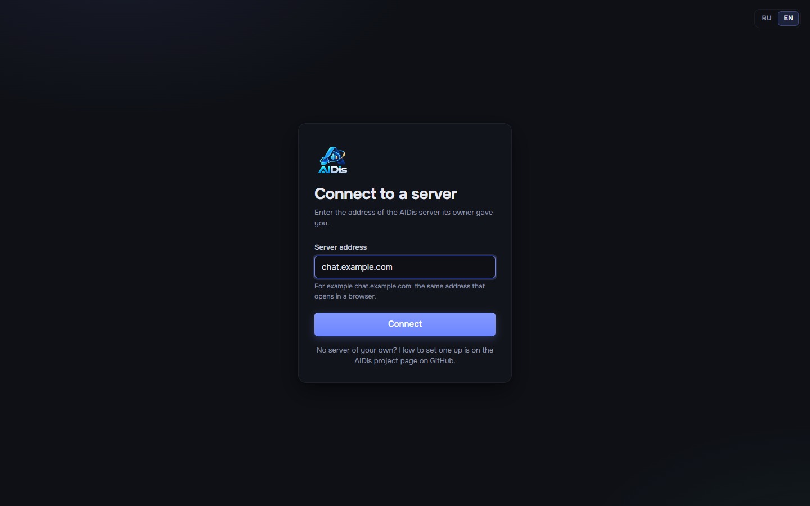

# AIDis

**Своё место для общения с друзьями: серверы с текстовыми и голосовыми каналами, звонки,
демонстрация экрана, трекер игр и приложение для Windows. Ваш VPS, ваш домен, ваши данные.**

[English version](README.md)



AIDis — для компании друзей, гильдии или небольшого сообщества, которым нужно что-то вроде больших
мессенджеров, но на своём сервере. Вы арендуете небольшой VPS, направляете на него домен, запускаете
один скрипт и заканчиваете настройку в браузере. AIDis ни с кем «домой» не связывается: у авторов нет
никаких серверов, от которых вы бы зависели.

## Что внутри

- **Серверы и каналы.** Текстовые и голосовые каналы, категории, роли и права, ссылки-приглашения,
  эмодзи сервера, журнал действий.
- **Чат.** Ответы, реакции, упоминания, правки, файлы и картинки, превью ссылок, голосовые
  сообщения, личные сообщения и друзья.
- **Голос и видео.** Звонки в голосовых каналах и личке, демонстрация экрана со звуком,
  шумоподавление, громкость каждого собеседника, звуковая панель. Звук и видео идут через ваш
  собственный LiveKit; позже можно добавить дополнительные голосовые серверы (например, ближе к
  части друзей).
- **Трекер игр.** Игры, запущенные на ПК, появляются сами вместе с наигранным временем; игры с
  консолей и телефона добавляются вручную. Статусы (играю, прошёл, 100%, дроп, пауза), полка в
  профиле, а если игру не запускали две недели — AIDis спросит, чем всё закончилось.
- **Приложение для Windows.** Глобальные горячие клавиши, настоящий push-to-talk, который работает в
  играх, выбор экрана со звуком системы, трей, автозапуск, уведомления. Одно приложение подключается
  к любому серверу AIDis и обновляется само с GitHub Releases.
- **Для владельца.** Мастер настройки в браузере при первом запуске, регистрация выключена / по
  приглашению / открытая, подтверждение почты и сброс пароля через ваш SMTP, панель
  администрирования, бэкап одной командой.
- **Приватно по умолчанию.** Никакой телеметрии. Обложки из Steam и поиск GIF выключены, пока вы их
  не включите. Интерфейс на русском и английском.

|  |  |
| --- | --- |
| Трекер игр в профиле | Ваши игры со статусами и платформами |
|  |  |
| Мастер первого запуска | Приложение спрашивает адрес сервера |

## Быстрый старт

Нужен VPS с Ubuntu 22.04 или 24.04 (от 2 ГБ памяти) и домен. Создайте две DNS-записи, указывающие
на VPS: `chat.example.com` и `rtc.chat.example.com` (подставьте свой домен). Затем на VPS:

```bash
sudo git clone https://github.com/OWNER/AIDis /opt/aidis
sudo bash /opt/aidis/deploy/setup.sh
```

Скрипт задаст три вопроса (домен, почта для сертификата, нужен ли голос), при необходимости поставит
Docker, получит HTTPS, соберёт и запустит всё и напечатает ссылку вида
`https://chat.example.com/setup?code=...`. Откройте её, создайте аккаунт администратора и первый
сервер и отправьте друзьям ссылку-приглашение.

По шагам, с тем, что вы должны увидеть на каждом шаге: [руководство по установке](docs/ru/install.md).

## Документация

| Руководство | О чём |
| --- | --- |
| [Требования](docs/ru/requirements.md) | Размер VPS, домен, DNS-записи, порты |
| [Установка](docs/ru/install.md) | `setup.sh` по шагам, VPS, где уже есть nginx или другие сайты |
| [Первый запуск](docs/ru/first-run.md) | Мастер в браузере, приглашение друзей, администрирование |
| [Приложение](docs/ru/desktop-app.md) | Установка приложения для Windows, адрес сервера, несколько серверов |
| [Голос](docs/ru/voice.md) | Как устроены звонки, порты, дополнительные голосовые серверы |
| [Почта и регистрация](docs/ru/mail-and-registration.md) | SMTP, режимы регистрации, сброс пароля |
| [Обновление](docs/ru/updating.md) | `update.sh`, версии приложения |
| [Резервные копии](docs/ru/backups.md) | Бэкап, восстановление, переезд на другой VPS |
| [Решение проблем](docs/ru/troubleshooting.md) | «Если видите X — делайте Y» |
| [Вопросы и ответы](docs/ru/faq.md) | Коротко |
| [Свои сборки приложения](docs/ru/build-your-own-app.md) | Сборка и публикация приложения из своего форка |

Для разработчиков (на английском): [Server](Server/README.md), [Client](Client/README.md),
[Desktop](Desktop/README.md), [участие](CONTRIBUTING.md), [безопасность](SECURITY.md).

## Лицензия

AIDis — свободная программа под лицензией **GNU Affero General Public License v3.0** (файл
`LICENSE`). Её можно запускать, менять и распространять. Если вы запускаете изменённую версию для
других людей по сети, вы должны дать им её исходный код.
