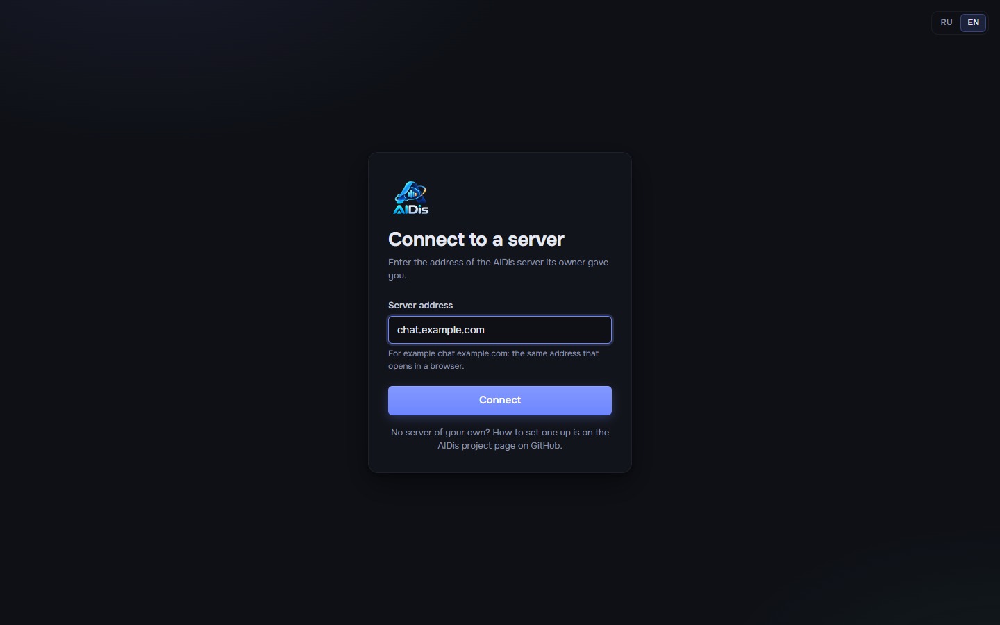

# Desktop app

[Back to README](../../README.md) · [Русский](../ru/desktop-app.md)

The Windows app is the same AIDis as the site, plus what a browser cannot do: global hotkeys,
push-to-talk inside games, a screen picker with system sound, tray, autostart, notifications and the
game tracker filling itself. One app works with every AIDis server; nobody needs a special build.

## Install

1. Open the **Releases** page of the AIDis repository on GitHub (`https://github.com/OWNER/AIDis/releases`)
   and download `AIDis-Setup-<version>.exe` from the newest release.
2. Run it. The installer is per user (no administrator rights) and asks for the language and folder.
3. Windows may say **"Windows protected your PC"**: the installer is not code-signed (a certificate
   costs money every year). Click **More info -> Run anyway**. Download it only from the official
   Releases page.

Windows 10/11, 64-bit.

## Connect to a server

On the first start the app asks for the **server address**: the same address that opens in a
browser, for example `chat.example.com`. Then log in as usual.

| Message | What it means |
| --- | --- |
| This does not look like a site address | a typo; write only the name, like `chat.example.com` |
| The address must use https:// | the app only connects over encryption; use the https address |
| The server does not answer | wrong address, no internet, or the server is down |
| A site opens at this address, but it is not AIDis | the domain is right but points at something else |

## Several servers

**Settings -> Desktop -> Servers** lists every server the app knows. **Switch** opens another one;
**Add a server** checks and adds a new address; the cross removes one (after confirmation). The app
remembers your login on each server separately, encrypted with your Windows account.

## Updates

The app checks for a new version on start and every 45 minutes, downloads it in the background and
offers **Restart and update**. Where it looks:

- by default, GitHub Releases of the repository it was built from;
- if the owner of your server set an update mirror ([Updating](updating.md#desktop-app-versions)),
  that mirror instead.

When the server requires a newer app than yours, the app asks you to update before connecting.

## Push-to-talk and hotkeys

**Settings -> Keybinds**: click an action, press the combination. Hotkeys work while a game is in
focus. Push-to-talk is switched on in **Settings -> Voice & audio -> Input mode**. A game started
**as administrator** hides key presses from other programs; then start AIDis as administrator too.

## Where things are

- Settings, logins and logs: `%APPDATA%\AIDis` (the logs: **Settings -> Desktop -> Open logs
  folder**; send them when you report a problem, they contain no passwords or tokens).
- Uninstall: Windows **Settings -> Apps -> AIDis -> Uninstall**.
