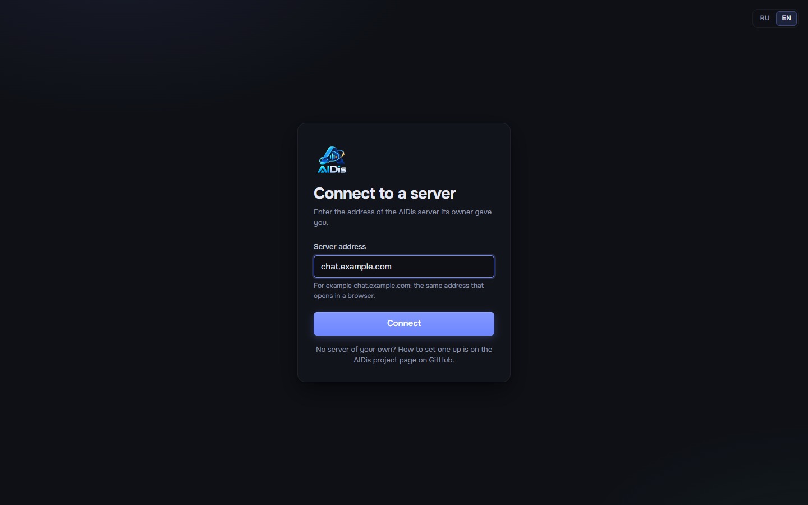

# Приложение для Windows

[К README](../../README.ru.md) · [English](../en/desktop-app.md)

Приложение — тот же AIDis, что и сайт, плюс то, чего не умеет браузер: глобальные горячие клавиши,
push-to-talk в играх, выбор экрана со звуком системы, трей, автозапуск, уведомления и трекер игр,
который заполняется сам. Одно приложение работает с любым сервером AIDis; особая сборка никому не
нужна.

## Установка

1. Откройте страницу **Releases** репозитория AIDis на GitHub
   (`https://github.com/OWNER/AIDis/releases`) и скачайте `AIDis-Setup-<версия>.exe` из самого нового
   релиза.
2. Запустите. Установка — для текущего пользователя (права администратора не нужны), спросит язык и
   папку.
3. Windows может написать **«Система Windows защитила ваш компьютер»**: установщик не подписан
   сертификатом (это платно каждый год). Нажмите **Подробнее -> Выполнить в любом случае**.
   Скачивайте только со страницы Releases официального репозитория.

Windows 10/11, 64-bit.

## Подключение к серверу

При первом запуске приложение спросит **адрес сервера** — тот же, что открывается в браузере,
например `chat.example.com`. Потом войдите как обычно.

| Сообщение | Что значит |
| --- | --- |
| Это не похоже на адрес сайта | опечатка; пишите только имя, например `chat.example.com` |
| Нужен адрес с https:// | приложение подключается только с шифрованием; нужен https-адрес |
| Сервер не отвечает | неверный адрес, нет интернета или сервер выключен |
| По этому адресу открывается сайт, но это не AIDis | домен верный, но указывает на что-то другое |

## Несколько серверов

**Настройки -> Приложение -> Серверы** — список всех серверов, которые знает приложение. **Перейти**
открывает другой; **Добавить сервер** проверяет и добавляет новый адрес; крестик убирает сервер
(после подтверждения). Вход на каждом сервере приложение помнит отдельно, в зашифрованном виде под
вашей учётной записью Windows.

## Обновления

Приложение проверяет новую версию при запуске и каждые 45 минут, скачивает её в фоне и предлагает
**Перезапустить и обновить**. Где оно ищет:

- по умолчанию — в GitHub Releases репозитория, из которого собрано;
- если владелец вашего сервера настроил зеркало обновлений ([Обновление](updating.md#версии-приложения)),
  то там.

Если сервер требует более новое приложение, чем ваше, приложение попросит обновиться до подключения.

## Push-to-talk и горячие клавиши

**Настройки -> Горячие клавиши**: нажмите на действие и нажмите сочетание. Клавиши работают, пока
активна игра. Push-to-talk включается в **Настройки -> Голос и звук -> Режим ввода**. Игра,
запущенная **от имени администратора**, прячет нажатия от других программ; тогда и AIDis запускайте
от администратора.

## Где что лежит

- Настройки, входы и журналы: `%APPDATA%\AIDis` (журналы: **Настройки -> Приложение -> Открыть папку
  журналов**; присылайте их, когда сообщаете о проблеме, — паролей и токенов в них нет).
- Удаление: **Параметры Windows -> Приложения -> AIDis -> Удалить**.
